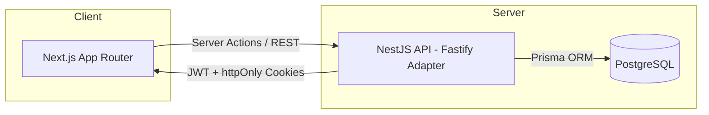

# Terceiro Gestor

**Plataforma SaaS multi-tenant para gestão do terceiro setor**, construída com NestJS (API REST) e Next.js (App Router). O objetivo é automatizar processos administrativos, indicadores de impacto e prestação de contas de organizações sociais, centralizando dados públicos para apoiar análises e tomada de decisão.

[](#)
[](#)
[](#)
[](#)
[](#)
[](#)
[](#)

---

## Arquitetura



- **Frontend:** Next.js (App Router), TypeScript, shadcn/ui — arquitetura *Server Component-first*, com Client Components tratados como "ilhas" isoladas apenas onde há interatividade.
- **Backend:** NestJS sobre adapter Fastify, expondo API REST, com autenticação via Server Actions e cookies httpOnly (sem exposição de token no client).
- **Banco de dados:** PostgreSQL modelado com Prisma, usando `uuid(7)` como estratégia de ID — ordenável por tempo de criação, importante no contexto multi-tenant para performance de índices.
- **Deploy:** Render (Next.js como static site, NestJS como web service, PostgreSQL gerenciado). Supabase avaliado como alternativa de banco, descartado como principal por causa do auto-pause em planos gratuitos.

## Decisões técnicas

- **Multi-tenant desde a modelagem de dados**, não como camada adicionada depois — decisão tomada para suportar múltiplas organizações sociais isoladas na mesma instância.
- **Server Actions em vez de lógica de autenticação client-side** — elimina race conditions de loading e reduz a superfície de ataque no frontend.
- **`AppLayout` como Server Component assíncrono**, resolvendo a sessão via `getCurrentUser()` no servidor e repassando os dados já resolvidos para o `AuthProvider` — o client nunca decide sozinho se o usuário está autenticado.
- **`uuid(7)` no Prisma** em vez de auto-increment ou `uuid(4)`, equilibrando unicidade global (necessária no multi-tenant) com ordenação temporal (necessária para performance de queries e paginação).
- **Fastify como adapter do NestJS** pela performance em relação ao Express, relevante dado o volume de requisições esperado de múltiplos tenants simultâneos.

## Stack

| Camada | Tecnologias |
|---|---|
| Frontend | Next.js (App Router), TypeScript, shadcn/ui |
| Backend | NestJS (Fastify), TypeScript, JWT |
| Banco de dados | PostgreSQL, Prisma ORM |
| Infraestrutura | Docker, Render |
| Versionamento | Git, Conventional Commits |

## Como rodar localmente

```bash
# Clonar o repositório
git clone https://github.com/TerceiroGestor/<nome-do-repo>.git
cd <nome-do-repo>

# Instalar dependências
npm install

# Configurar variáveis de ambiente
cp .env.example .env

# Rodar migrations do Prisma
npx prisma migrate dev

# Subir em modo desenvolvimento
npm run start:dev
```

> Ajuste os comandos acima conforme a estrutura final do(s) repositório(s) — API e Web, se estiverem separados.

## Roadmap

- [x] Fase 0 — Planejamento de arquitetura (backend + frontend + execução no GitHub)
- [x] Fase 1 — Modelagem multi-tenant e autenticação
- [ ] Fase 2 — Módulos de gestão administrativa
- [ ] Fase 3 — Indicadores de impacto e prestação de contas
- [ ] Fase 4 — Centralização de dados públicos e análises sociais/territoriais
- [ ] Fase 5 — Deploy de produção e observabilidade

## Sobre o projeto

Organizações da sociedade civil (OSCs) frequentemente não têm ferramentas acessíveis para acompanhar sua gestão do início ao fim — da abertura à prestação de contas exigida pelo Marco Regulatório do Terceiro Setor (MROSC, Lei 13.019/2014). O Terceiro Gestor nasce para preencher essa lacuna, oferecendo recursos gratuitos e centralizando dados sociais públicos que ajudam OSCs, Estado e sociedade civil a tomar decisões melhor embasadas.

## Autor

<div align="center">
  
  <br/>
  <b>Weverton Campos</b> — Desenvolvedor Backend (Node.js • NestJS • TypeScript)
  <br/>
  <a href="https://github.com/wevertoncamposdev">GitHub</a> · <a href="https://www.linkedin.com/in/wevertoncamposdev">LinkedIn</a>
</div>
